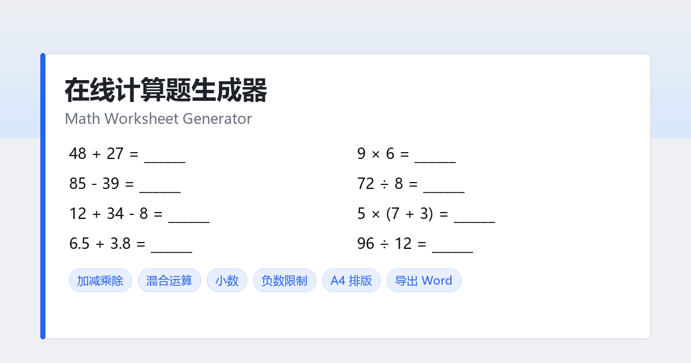

# 在线计算题生成器 · Math Worksheet Generator

一个零构建、纯静态的小学数学计算题练习卷生成器，打开网页即可出题、排版、导出打印。

- 在线使用：<https://quietdw.github.io/math-worksheet/>
- English UI：<https://quietdw.github.io/math-worksheet/?lang=en>



## 功能

- **运算类型**：加法、减法、乘法、除法、加减混合、乘除混合、综合混合
- **运算数量**：每题 2–4 个数字
- **数字类型**：整数 / 小数（1 位或 2 位小数）
- **负数限制**：开启后每一步中间结果与最终结果都不小于 0，减法自动保证被减数 ≥ 减数
- **范围控制**：数字范围（含 10 / 20 / 100 / 1000 以内快捷）、结果范围
- **题量与排版**：最多 2000 题，2/3/4 列 × 20/25/30 行，A4 竖版
- **显示选项**：字号、表头（班级 / 姓名 / 日期 / 得分）、答案显示
- **导出**：Word 题目卷、Word 答案卷、打印 / 另存为 PDF、网页文件
- **界面语言**：中文 / English 一键切换，`?lang=en` 可直接打开英文版
- **明暗主题**：跟随系统偏好，可一键切换深色 / 浅色并记忆选择；练习卷本身始终为白色，便于打印
- **体验细节**：参数即时生效、预览缩放（适应宽度 / Ctrl + 滚轮）、参数与语言本地记忆、标题栏 GitHub 图标直达仓库

## 使用

直接用浏览器打开 `index.html` 即可，无需安装依赖、无需构建。

```bash
# 本地起一个静态服务（可选）
python -m http.server 8080
# 然后访问 http://localhost:8080/
```

出题逻辑说明：

- 除法按整数商反推除数，整数模式下保证整除，且不会出现 `÷1`、`86 ÷ 86` 这类无意义题
- 小数模式下，连乘/连除的中间结果按小数位数对齐，答案不会出现四五位小数
- 负数限制在构造阶段保证，而非生成后重试过滤

## 文件结构

| 文件 | 说明 |
| --- | --- |
| `index.html` | 应用本体（HTML + CSS + JS 单文件，含中英文案） |
| `og-image.png` | 社交分享预览图 1200×630 |
| `apple-touch-icon.png` / `favicon.svg` | 站点图标 |
| `robots.txt` / `sitemap.xml` | 搜索引擎抓取配置与站点地图 |
| `404.html` | GitHub Pages 自定义 404 页 |
| `math-practice-generator.html` | 旧地址跳转页，保留兼容 |
| `.nojekyll` | 关闭 GitHub Pages 的 Jekyll 处理 |

## 部署

仓库根目录即为站点根目录，GitHub Pages 选择 `main` 分支 `/(root)` 即可发布。
`index.html` 使用相对路径引用图标与资源，放在任意子目录下都能正常运行。

## 浏览器支持

Chrome / Edge / Firefox / Safari 现代版本。Word 导出依赖 [docx.js](https://github.com/dolanmiu/docx)（首次导出时按需加载），若 CDN 不可达会自动降级为导出 `.html` 文件。

## 参考与致谢

交互与排版思路参考了 [jesus.xin](https://jesus.xin/) 的在线计算题生成器，本实现重写了出题引擎、预览排版与 Word 导出，并补充了负数限制、答案卷、中英文切换等功能。

## License

MIT
